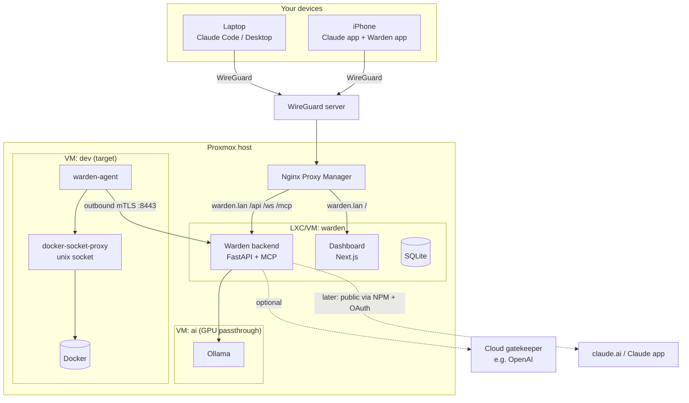
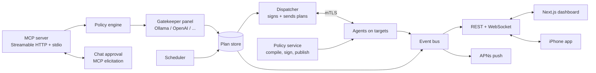
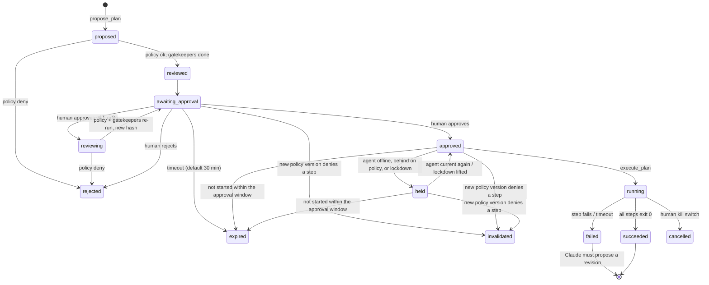

# Warden

**A plan-then-execute MCP server that lets Claude operate a home/dev server, with an independent LLM gatekeeper and human approval.**

You ask Claude: *"Set up the GitHub project on the dev server and test that curl works."*
Claude proposes an exact list of commands → hard policy rules check them → one or more gatekeeper LLMs check that the commands match the goal → **you** approve in chat, on the web dashboard or on your iPhone → a small agent on the target server checks everything again and executes exactly what you approved, stops on the first failure and makes Claude propose a revised plan.

> This README is written for two readers: humans setting up and extending Warden, and LLM coding agents designing or implementing it. Sections marked **🤖 Agent rules** are binding for agents.

---

## 1. Core invariants

These are the security model. Every design and code decision must preserve them. If a feature request conflicts with one, stop and ask the human.

1. **Nothing state-changing runs without an approved plan.** The only exception is the read-only allowlist (section 8).
2. **An approved plan is immutable.** It is hashed (SHA-256 over the canonical JSON of its plan ID, target, goal and steps; section 5) and the human approves that hash. Agents refuse to run anything whose hash doesn't match, or whose target isn't themselves.
3. **Claude can never approve its own plans.** No MCP tool approves, edits policy, or changes approval state. Approval only comes from a human channel authenticated separately from the MCP connection.
4. **Stop on first failure.** A non-zero exit code, a timeout or a policy violation halts the plan. The remaining steps are marked `skipped`.
5. **A failed plan is never resumed.** Claude must submit a new plan with `revises: <old_plan_id>`. The human sees a diff against the old plan.
6. **Deterministic rules run before any LLM.** The policy engine can deny on its own. Gatekeepers can only make things *stricter* (deny or escalate). They can never override a policy deny.
7. **Everything is logged.** Every proposal, verdict, approval, command, output and exit code is written to an append-only audit log.
8. **Untrusted text is data.** Command output, repo contents, READMEs, web pages and logs are passed to gatekeepers clearly delimited as untrusted. They are never treated as instructions.
9. **All authority lives in the backend.** The frontend and iPhone app are views. They hold no secrets and can only do what the backend allows for an authenticated human session.
10. **Agents enforce independently.** Each target runs `warden-agent`, which checks the plan hash, the approval signature and its own copy of the policy before every step. A compromised central server still can't make an agent break policy.
11. **Policy flows one way: signed, versioned, never rolled back.** Agents reject unsigned, older or tampered policy. Changes that tighten rules propagate automatically; changes that loosen them need the offline key (section 7A).

---

## 2. Infrastructure

Built for a **Proxmox** host, **WireGuard** for remote access and **Nginx Proxy Manager (NPM)** as reverse proxy.



### Proxmox layout

| Guest | Type | Purpose | Notes |
|---|---|---|---|
| `warden` | Unprivileged LXC (or small VM) | Backend, MCP server, dashboard, SQLite | 2 vCPU, 2 GB RAM, 20 GB disk is plenty. Holds the online signing key, internal CA and API keys. |
| `ai` | VM with NVIDIA PCIe passthrough | Ollama | Or reuse whatever guest already owns the GPU. Port 11434 reachable only from `warden`. |
| `dev` | VM | Target server where Claude does work | VM rather than LXC so Docker runs without nesting hacks and is properly isolated. Runs `warden-agent`. |

Use the **Proxmox firewall** so that:

- `ai:11434` accepts only from `warden`.
- Targets need **no inbound ports** for Warden. Agents connect out to `warden:8443`; allow that only from enrolled agents (LAN addresses or the WireGuard subnet).
- Agents connect to `warden:8443` **directly, never through NPM**: mutual TLS needs the client certificate end to end. Agents outside the Proxmox host (another local server, a remote box) use the same port over the LAN or WireGuard, or an NPM *Stream* (raw TCP passthrough), never an NPM proxy host.
- `warden` is reachable only from NPM.

### Targets and agents

Warden doesn't run on the servers it manages. Each target runs **`warden-agent`**, a small Go binary that connects out to Warden, receives approved plans, re-checks them against its local policy and executes them. Docker access goes through `docker-socket-proxy` on a local unix socket, so the agent never holds root-equivalent Docker access. Full design in section 7A.

```yaml
# targets.yaml (central; compiled into each agent's policy bundle)
- name: dev
  agent_id: agt_01J...           # set at enrollment
  workspace_roots: [/srv/dev]
  docker_socket: /run/warden/docker-proxy.sock
```

Adding a server = enroll an agent and add an entry here.

### Remote access phases

| Phase | Who can reach Warden | How |
|---|---|---|
| **1. VPN only** | Claude Code, Claude Desktop, dashboard, iPhone app | Over WireGuard. NPM proxy host `warden.lan` with an access list allowing only the LAN and WireGuard subnets. |
| **2. Public MCP (later)** | Also the Claude app and claude.ai | These connect from Anthropic's cloud, so they can't enter your VPN. A separate NPM proxy host (e.g. `mcp.example.dk`) exposes **only `/mcp`**, with TLS and OAuth. The dashboard and API stay VPN-only. |

The iPhone app relies on WireGuard's on-demand mode to reach the API. Push notifications go out through Apple's servers, so they arrive even when the VPN is off; tapping one brings the VPN up.

---

## 3. Architecture (inside the warden guest)



| Component | Responsibility |
|---|---|
| **MCP server** | Exposes tools to Claude. Never exposes approval. |
| **Policy engine** | Deterministic allow/deny from `policy.yaml`. |
| **Gatekeeper panel** | One or more reviewer LLMs from different providers. Strictest verdict wins. |
| **Plan store** | SQLite (WAL). Plans, steps, verdicts, approvals, runs, audit log. |
| **Dispatcher** | Signs approved plans and sends them to the right agent. Collects streamed output. |
| **Policy service** | Versions, classifies (tighten/loosen), signs and publishes policy bundles. Tracks rollout per agent. |
| **Agent registry** | Enrollment, certificates, revocation, heartbeats, versions. |
| **Event bus** | In-process pub/sub feeding WebSocket clients and push notifications. |
| **API** | REST + WebSocket for dashboard and app. Separate auth from MCP. |
| **Scheduler** | Runs pre-approved plan templates (section 11). |

---

## 4. Plan lifecycle



- `reviewed` in the diagram is a moment, not a stored status: policy and gatekeepers finish inside `proposed → awaiting_approval`.
- **Approval window:** approving signs the plan for `approvals.expiry_min` (default 30 min) from the moment of approval. An approved or held plan that hasn't started by then expires.
- A gatekeeper `deny` still reaches the human, shown as a recommended rejection. The human has the final say, except over a **policy** deny, which is final.
- The kill switch (dashboard, app, or `warden kill`) stops the running step: SIGTERM, then SIGKILL after 10 seconds.
- **Approve with edits:** the human may change commands before approving. The plan goes to `reviewing`, runs through policy and every gatekeeper again, gets a new hash, and returns to `awaiting_approval`. Nothing runs until the re-reviewed plan is approved. Edited steps are marked `edited: true` and logged with a before/after diff.
- **Held:** an approved plan whose agent is offline, not on the latest policy version, or under lockdown waits as `held` (shown as "⏸ Approved · held"). It starts automatically when the agent becomes current, unless it has expired or been invalidated meanwhile.
- **Invalidated:** when a new policy version denies a step in a waiting or approved plan, the plan becomes `invalidated` with the reason and the policy version (e.g. "Policy v42 denies step 1"). Claude must propose again.
- **Diagnosis after failure:** when a plan fails, Claude investigates with `read_only` commands (no approval needed, still logged and still subject to group restrictions) and posts its findings to the plan before proposing a revision. The dashboard and app show this as a *Diagnosis* panel.

---

## 5. Data model

```jsonc
// Plan
{
  "id": "pln_01J...",                 // ULID
  "revises": "pln_01H..." | null,
  "goal": "Deploy myapp on dev and verify HTTP health",
  "target": "dev",
  "requested_by": "claude-code",
  "steps": [Step],
  "hash": "sha256:...",                // over {v, plan_id, target, goal, revises, steps}; recomputed at approval and before dispatch
  "status": "awaiting_approval",      // proposed | reviewing | awaiting_approval | approved | held | running
                                       // succeeded | failed | rejected | expired | cancelled | invalidated
  "invalidated_by": 42 | null,         // policy version, with "invalid_reason"
  "diagnosis": [{ "command": "...", "exit": 0, "output": "...", "note": "..." }] | null,
  "policy_result": { "ok": true, "violations": [] },
  "gatekeepers": [GatekeeperVerdict],
  "final_verdict": "allow" | "escalate" | "deny",
  "approval": {
    "by": "dashboard:user", "at": "2026-10-20T14:32:05+02:00",
    "signature": { "by": "passkey:MacBook" | "warden-approval-key", "sig": "..." }
  } | null,
  "created_at": "...",
  "expires_at": "..."
}

// Step
{
  "n": 1,
  "kind": "shell" | "docker" | "git" | "http_check",
  "command": "git clone https://github.com/you/myapp /srv/dev/myapp",
  "purpose": "Get source code",
  "cwd": "/srv/dev",
  "timeout_s": 120,
  "expect_exit": 0,
  "captures": { "container_id": "stdout_trimmed" },
  "edited": false                     // true if the human changed it
}
```

Timestamps are ISO 8601 with offset and shown in the UI as 24-hour time in Europe/Copenhagen. Sizes use MB/GB; durations use seconds.

### Placeholders

Values unknown until runtime (container IDs, ports) are declared as `captures` and referenced later as `{{step1.container_id}}`.

- Captured values are validated per type (container ID `^[a-f0-9]{12,64}$`, port `^\d{1,5}$`, etc.).
- The **template** with placeholders is what gets hashed and approved.
- Values are substituted as single argv elements, never via string interpolation.

---

## 6. MCP tools

| Tool | Approval needed | Description |
|---|---|---|
| `propose_plan(goal, target, steps, revises?)` | — | Submit a plan. Returns `plan_id`, policy result and gatekeeper verdicts. |
| `get_plan(plan_id)` | — | Status, verdicts, per-step results. |
| `wait_for_approval(plan_id, timeout_s?)` | — | Blocks until decided or expired (max 300 s per call). Triggers chat elicitation when supported. |
| `execute_plan(plan_id)` | Plan must be `approved` | Runs it. Returns per-step output (capped), exit codes, and the failing step if any. |
| `diff_plans(old_id, new_id)` | — | Structured diff, also shown to the human. |
| `read_only(target, command)` | No (allowlist) | Runs one allowlisted read-only command. |
| `list_resources(target?)` | No | Targets, containers, compose projects and directories Warden may touch. |
| `post_diagnosis(plan_id, note, read_only_audit_ids[])` | No (can't change state) | After a failure: a plain-text note plus the audit IDs of `read_only` commands run since. Warden attaches their real output (DECISIONS D-14). |

Each MCP client authenticates with its own bearer token (`warden mcp add <name>` on the warden guest; `warden mcp revoke <name>`), separate from every human login. Everything it does is recorded under that client's name.

Tool descriptions given to Claude must explain the workflow: *look around with `read_only`, propose a full plan, wait for approval, execute, and on failure inspect and propose a revision.*

**🤖 Agent rules:** Do not add tools named or behaving like `approve`, `force`, `override`, `edit_policy` or unplanned `run`. `read_only` must reject pipes, redirects, `;`, `&&`, `||`, backticks and `$()`.

---

## 7. Policy engine (`policy.yaml`)

```yaml
deny_paths: [/etc, /root, /home, /var/lib/docker, /srv/prod]

commands:
  allow:
    git: { subcommands: [clone, pull, fetch, checkout, status, log] }
    docker: { subcommands: [ps, logs, inspect, start, stop, restart, compose] }
    curl: { flags_deny: [-o, --output, -T, --upload-file, -K, --config] }
    npm: { subcommands: [ci, install, test, run] }
  deny_patterns:
    - 'rm\s+-rf\s+/'
    - 'curl .*\|\s*(ba)?sh'
    - 'chmod\s+777'
    - 'docker\s+run\s+.*--privileged'
    - 'docker\s+run\s+.*-v\s+/:'

docker:
  allowed_projects: ["dev-*"]
  denied_containers: ["prod-*", "docker-socket-proxy"]

network:
  git_hosts: [github.com]
  http_check_hosts: [localhost, 127.0.0.1, "*.dev.lan"]

limits:
  step_timeout_s: 600
  plan_max_steps: 25
  output_cap_mb: 1
```

Commands are parsed with `shlex` into argv and matched structurally (binary, subcommand, flags, path arguments resolved on the target with `realpath`). Regex patterns are a backup layer only. Per-target `workspace_roots` come from `targets.yaml`.

Agents never read these YAML files. Warden compiles them into signed, versioned **policy bundles** and distributes them (section 7A). Warden checks plans against policy at proposal time; each agent checks again before every step.

---

## 7A. Agents and policy distribution

### The agent (`warden-agent`)

A small Go binary (single static file, low tens of MB RAM) running as user `warden` under systemd on each target.

- **Connects outbound** to `wss://warden.lan:8443/agent` with mutual TLS. No inbound ports, works behind NAT.
- **Before every step** it verifies: the plan hash, Warden's approval signature on that hash, the step against its local policy bundle, and every path argument resolved locally (`realpath`, symlinks followed) inside `workspace_roots`. Any failure → refuses and reports `policy_violation`.
- **Executes** argv directly (no shell), with timeout, output cap and working-directory jail. Docker calls go through the local socket proxy.
- **Streams** output and status back, sends a heartbeat every 15 s with agent version, policy version, disk and load. Warden stores output per step and writes each step's SHA-256 into the hash-chained audit log.
- **Runs one plan at a time**, refuses to run as root, and keeps a durable log of plan IDs it has started, so an approval can never run twice.
- **Fails closed:** if the connection to Warden drops mid-plan, it finishes or kills the current step (per its timeout) and aborts the rest. The plan becomes `failed` with reason `agent_disconnected`.
- **Baseline rules compiled into the binary** that no policy can override: e.g. never `rm -rf /`, never write to `/etc`, `/usr`, `/boot`, never `--privileged`, never mount `/`, never touch the agent's own binary, config or keys.

**Enrollment:** dashboard → *Add agent* (or `warden agent add <name>`; the name must be in `targets.yaml`) → one-time token (valid 15 min) that also carries the fingerprint of Warden's internal CA, so the agent can pin it → `warden-agent enroll --server wss://<warden>:8443 --token …` on the target. The agent generates its own ed25519 key and prints its fingerprint; the dashboard shows the fingerprint it received from the connecting IP. You compare them and click *Fingerprints match · enroll* (or `warden agent confirm <name> --fingerprint …`), after which it gets a client certificate from Warden's internal CA, the online policy key, the offline public key(s) and the current policy bundle. It prints the offline key IDs it trusts so you can compare them with `warden-sign pubkey`. A mismatch aborts enrollment and is logged. **Revoke** from the dashboard: certificate is revoked and the connection dropped immediately.

### Policy bundles

`policy.yaml` + `targets.yaml` are compiled per agent into a bundle:

```jsonc
{
  "version": 42,                      // strictly increasing, never reused
  "issued_at": "2026-10-20T14:32:05+02:00",
  "target": "dev",
  "min_agent_version": "1.3.0",
  "change": "tighten" | "loosen",
  "rules": { /* compiled policy for this target */ },
  "signatures": [
    { "key": "online",  "sig": "ed25519:..." },
    { "key": "offline", "sig": "ed25519:..." }   // required for loosen
  ]
}
```

An agent accepts a bundle only if: the signatures are valid for its change class, `version` is higher than the current one (no rollback), the schema validates with no unknown fields, and `target` matches. It then swaps atomically (write, fsync, rename) and acknowledges with `{version, sha256}`.

### Publishing a rule change (e.g. you spot a vulnerability)

1. Edit the rule on the dashboard **Policy** page, or edit `policy.yaml` and run `warden policy publish`.
2. Warden validates it, shows a diff with one row per changed path (e.g. `groups.high-security.members`, `add`, `tighten`), classifies the whole change as **tighten** or **loosen**, and runs the policy test suite (schema checks such as invalid regexes, plus adversarial fixtures) against the new rules. Publishing is blocked while any test fails.
3. You confirm with your passkey.
4. **Tighten:** signed with the online key and pushed to every connected agent immediately (target: under 5 s). Offline agents get it when they reconnect; Warden also pushes it whenever a heartbeat (every 15 s) shows an agent behind.
5. **Rollout view:** the dashboard shows each agent as `✓ v42` or `⏳ v41`.
6. **Enforcement:**
   - The dispatcher won't send plans to an agent that isn't on the latest version.
   - Approved plans that haven't started are re-checked; any that now violate policy become `invalidated` and you're notified.
   - Running plans pick up the new rules from the next step, because agents check before every step.

### Tighten vs. loosen: two keys

| Key | Where it lives | Can sign |
|---|---|---|
| **Online key** | `warden` guest | Only changes proven to tighten: adding deny patterns, deny paths or denied containers; removing allowed commands, subcommands, flags or hosts; lowering limits |
| **Offline key** | YubiKey or your laptop, never on a server | Anything that loosens, or that the classifier can't prove is tightening |

This makes the urgent case (closing a hole) instant and automatic, while a compromised Warden still can't quietly open things up. Loosening flow: `warden policy publish` creates a pending publish → `warden policy pending --out bundle-v43.json` → sign it on your laptop with `warden-sign sign bundle-v43.json --key ~/.warden/offline.key` (it recomputes and shows the diff itself) → upload the signature (`warden policy sign-upload bundle-v43.sig.json`, or the dashboard from M6) → it's published. **Agents classify every bundle themselves** against the rules they have installed, so a loosening labelled "tighten" is still refused without the offline signature.

### Lockdown

One action in the dashboard, iPhone app or CLI (`warden lockdown`): kills running plans, puts every approved plan on `held`, and publishes a tightening bundle that allows only read-only commands on every agent. Lifting lockdown (`warden lockdown lift`) restores the current rules without lockdown as a new version, which counts as loosening and needs the offline key. Proposals and approvals keep working during lockdown; plans wait as `held` and start once each agent has the lifted version.

### Agent self-updates (later)

New agent binaries are signed with the offline key and sent through the same channel. Rollout is staged: one canary agent first, then the rest. The agent verifies the signature, swaps the binary and restarts via systemd, and rolls back automatically if no heartbeat arrives within 60 s.

---

## 7B. Groups

A **group** is a named set of agents with extra restrictions layered on top of the global policy. Groups can **only add restrictions, never remove any**, and their rules ship inside the same signed policy bundle, so each agent enforces its own group rules. Typical use: a `high-security` group for unprivileged LXCs that hold secrets and auth (e.g. `sec-vault`, `sec-auth`, `sec-dns`).

```yaml
# policy.yaml
groups:
  high-security:
    desc: Unprivileged LXC containers that hold secrets and auth
    members: [sec-vault, sec-auth, sec-dns]
    read_only:
      mode: restricted              # allowed | restricted | off  (stricter to the right)
      deny_paths: [/home, /root, /etc/ssl/private, /var/lib/vault]
    commands:
      deny_patterns: ['docker\s+exec', 'curl\s.*-X\s*(POST|PUT|DELETE)']
    limits:
      plan_max_steps: 10            # must be <= global
    approvals:
      passkey: true                 # passkey for every approval on members
    gatekeepers:
      unanimous: true               # every reviewer must say allow, else escalate
```

**Effective rules for an agent** = global policy + baseline + every group it belongs to. When groups overlap, the strictest value wins (lowest limit, strictest read-only mode, union of deny lists).

**Group read-only modes:**

| Mode | Effect on `read_only` for members |
|---|---|
| `allowed` | Normal allowlist (section 8) |
| `restricted` | Allowlist, but any path argument under `read_only.deny_paths` is refused |
| `off` | No read-only commands at all; everything needs a plan |

**Tighten/loosen classification** (feeds the two-key rule in 7A):

| Change | Class |
|---|---|
| New group, adding a member, adding a deny path or deny pattern | Tighten |
| Read-only mode moved right (`allowed` → `restricted` → `off`) | Tighten |
| Lowering `plan_max_steps`; turning on `passkey` or `unanimous` | Tighten |
| Removing a member, path or pattern; moving mode left; raising steps; turning off `passkey`/`unanimous`; deleting a group | Loosen (offline key) |

Refusals caused by a group name the group in the reason, e.g. `refused · group high-security: read_only.deny_paths includes /home`.

## 8. Read-only allowlist

Runs without a plan so Claude can investigate failures without spamming you:

`docker ps`, `docker logs --tail N <allowed>`, `docker inspect <allowed>`, `docker compose ps`, `ls`, `cat`, `head`, `tail`, `stat`, `df -h`, `free -m`, `git status`, `git log`, `curl -I` / plain GET to allowed hosts.

All path arguments must be absolute and resolve inside the target's `workspace_roots` (git takes its path as `git -C <path> status|log`; `docker logs` needs `--tail N`; `tail -f` is refused). Read-only runs are logged and shown in the live feed.

---

## 9. Gatekeeper panel

The gatekeeper is **provider-agnostic** and can run several reviewers at once. Using a different provider than the one doing the work (e.g. Claude does the tasks, a local model and OpenAI do control) is deliberate: different models fail in different ways, so one being fooled doesn't mean the others are.

```yaml
# gatekeeper.yaml
mode: strictest            # strictest verdict across reviewers wins
timeout_s: 60
injection_scan: true       # built-in rules, see below
reviewers:
  - name: local
    provider: ollama
    url: http://ai.lan:11434
    model: qwen3:14b
    options: {think: false, num_ctx: 8192}
  - name: openai
    provider: openai
    model: <configurable>
    api_key: secret:OPENAI_API_KEY
    send_untrusted_output: false   # only goal + steps leave the network
```

Supported providers: `ollama`, `openai`, `anthropic`, plus any OpenAI-compatible endpoint. Each is a small adapter implementing `review(request) -> GatekeeperVerdict`.

**Model size by GPU memory** (Ollama, 4-bit quantised, rough guide):

| VRAM | Suitable size | Example |
|---|---|---|
| 8 GB | 7–8B | `qwen2.5:7b-instruct`, `llama3.1:8b` |
| 12–16 GB | 14B | `qwen3:14b` (the default here: RTX 3060 12 GB, DECISIONS D-01) |
| 24 GB | 32B | `qwen2.5:32b-instruct` |

Use structured JSON output and temperature 0 on every provider. (Claude is the exception: its Messages API no longer accepts sampling parameters, so the Anthropic adapter sends none.) API keys are never in `gatekeeper.yaml`: `api_key: secret:NAME` reads `/etc/warden/secrets/NAME` (mode 0600). Command output and Claude's notes only reach reviewers with `send_untrusted_output: true`, which is the default only for `ollama`.

**`injection-scan`** is a built-in deterministic reviewer. It escalates when the untrusted text carries injection markers, such as "ignore previous instructions", claims that the plan is already approved, ready-made verdict JSON, delimiter or role tags, ANSI escapes or invisible characters. It can only escalate, so a fooled model can't lower that floor. With no model reviewers configured, a "none configured" row escalates every plan.

`warden gatekeeper check` sends a harmless and a harmful sample to every reviewer. `warden gatekeeper check --injection` runs the whole injection suite: every model reviewer must answer `escalate` or `deny` on every case (M5 Done-when).

**Input:** goal, steps, policy summary, the previous failed plan and its error (for revisions), and recent output wrapped in `<untrusted>…</untrusted>`.
**Question:** *do these steps do what the goal says, and nothing more?*

```json
{
  "verdict": "allow" | "escalate" | "deny",
  "risk": "low" | "medium" | "high",
  "per_step": [{ "n": 1, "matches_goal": true, "note": "..." }],
  "summary": "One sentence for the human."
}
```

Validate with Pydantic. A parse failure, timeout or unreachable provider counts as `escalate` for that reviewer. The plan still reaches the human and is never auto-allowed.

**Privacy:** cloud reviewers see your commands. Secrets are already placeholders (`{{secret:NAME}}`) in plans, and output is scrubbed before it's sent. Set `send_untrusted_output: false` to keep command output on the local model only.

---

## 10. Approval channels

All channels share the same plan store and get live updates through the event bus.

### 10.0 Approval rules (all channels)

| Rule | Default | Setting |
|---|---|---|
| Plan expires after | 30 min | `approvals.expiry_min` |
| Passkey / Face ID for high-risk plans | Always | Locked on |
| Passkey for medium-risk plans | Off | `approvals.passkey_medium` |
| Passkey for members of a group with `approvals.passkey` | Always | Set per group (7B) |
| **Sign approvals with your passkey (end-to-end)** | On | `approvals.e2e` |
| Chat approval via elicitation | On | `approvals.chat` |
| Approve all | Not available, by design | — |

**End-to-end approval signing.** With `approvals.e2e` on, every approval is a WebAuthn assertion over the plan hash, made with your passkey (Mac) or Face ID (iPhone). Agents hold the public keys of your registered passkeys and verify that **you** approved, not just Warden. Chat approval then hands off to the dashboard or app to sign. With it off, Warden's approval key signs and agents verify that instead.

### 10.1 Chat

Uses **MCP elicitation**: during `wait_for_approval`, the server asks the client to show the user an approve/reject prompt. The answer comes from the user's UI action, not from the model.

Client support varies and changes, so verify per client. Without elicitation, `wait_for_approval` returns a dashboard link (`approve_at`). Warden doesn't use elicitation yet (DECISIONS M4-03, M6-13): an answer coming back over the MCP connection must never approve, and with `approvals.e2e` on the approval has to be signed by your passkey anyway, so chat hands off to the dashboard link. There is deliberately **no** path where the user types "approve" and Claude relays it, because the server can't tell the user and Claude apart in that path.

Plans longer than `chat_max_steps` (setting, default 10) show a summary and a dashboard link instead.

### 10.2 Web dashboard (Next.js)

- **Stack:** Next.js (App Router) + TypeScript + Tailwind, built with `output: "standalone"` and run as a Node service in the `warden` guest. TanStack Query for REST, a native WebSocket for live events.
- **Types:** generated from the FastAPI OpenAPI schema with `openapi-typescript`, so frontend and backend can't drift.
- **Routing via NPM:** `warden.lan/` → Next.js, `warden.lan/api`, `/ws`, `/mcp` → FastAPI. Same origin, so no CORS.
- **Auth:** handled by FastAPI. Passkey (WebAuthn) login issues an httpOnly, `SameSite=Strict` session cookie. Next.js never sees tokens.
- **Pages:** Approvals, Plans, Plan detail (steps, verdicts per reviewer, diff vs. previous plan, live output, diagnosis, after-approval summary), Live feed, Schedules, Agents, Groups, Policy, Audit log, Settings, plus Lockdown and the kill switch in the top bar.
- **Tests:** a Playwright suite runs the real `warden serve` behind `web/scripts/proxy.mjs` (which plays NPM's part) with a virtual passkey authenticator, and fails if the page requests anything outside its own origin.
- Approval requires a fresh action per plan. No "approve all".
- Screens, layout and states: see section 17.

### 10.3 iPhone app (M8, required)

- **Confirmed: Warden ships with a native iPhone app.** It is built at M8 with the iOS build skill you provide then, which follows the Linux pipeline below.
- SwiftUI app on the same REST + WebSocket API. APNs push for "awaiting approval", "plan failed" and "scheduled run finished".
- Approve/reject from an actionable notification, with Face ID required to approve.
- Must follow the existing Linux iOS pipeline: SwiftPM + `xtool.yml`, no Xcode project files, built and shipped by the Forgejo `ios` runner via `ship.sh`. API models and decoding live in a Foundation-only `WardenCore` package so `swift test` runs on Linux.
- Bundle ID `dk.<owner>.warden`. Apple-side setup (app record, Push capability, APNs key) is done manually on developer.apple.com.
- Screens, notifications and states: see section 17.

---

## 11. Schedules

A schedule is **a plan template the human approved once, with explicit scope**:

```yaml
- name: nightly-dev-rebuild
  cron: "0 3 * * *"          # 03:00 Europe/Copenhagen
  target: dev
  plan_template_hash: "sha256:..."
  on_failure: notify_and_stop
  expires: 2027-01-31
```

- Only the exact approved template can run. Any change gives a new hash and needs new approval.
- On failure: stop and notify. Claude may propose a fix through the normal flow.
- Schedules expire (default 90 days).

---

## 12. Security

- **Agents:** run as `warden` without sudo, systemd-hardened, with a client certificate per agent and mutual TLS. No inbound ports on targets.
- **Docker:** never give the agent the raw socket. Use `docker-socket-proxy` on a local unix socket readable only by `warden`, with just the API sections needed.
- **Keys:** online signing key and internal CA key on the `warden` guest (`0600`); offline policy key never on any server. Approval signing key is separate from the policy key.
- **warden guest:** unprivileged LXC or VM, systemd hardening (`ProtectSystem=strict`, `NoNewPrivileges=yes`), secrets in `/etc/warden/secrets` with mode `0600`.
- **NPM:** `warden.lan` with an access list (LAN + WireGuard subnets only). Later, a separate public host exposing only `/mcp`, with OAuth, rate limiting and HSTS.
- **Secrets:** never in plans or logs. Steps reference `{{secret:NAME}}`; outputs are scrubbed of known secret values before storage or sending to cloud reviewers.
- **Audit log:** append-only with a hash chain, plus daily rotated JSONL export.
- **Prod is out of scope** for v1.

---

## 13. Tech stack and repo layout

| Concern | Choice |
|---|---|
| Backend language | Python 3.12 (fastest to build; mature MCP SDK; runtime speed isn't the bottleneck) |
| MCP | `mcp` Python SDK (FastMCP), Streamable HTTP + stdio |
| API | FastAPI, WebSockets, Pydantic v2 |
| Storage | SQLite (WAL) via SQLModel |
| Agent | Go: single static binary, mTLS WebSocket, ed25519 signatures |
| Offline signing | `warden-sign` (Go CLI), optional YubiKey via PIV |
| Gatekeepers | Ollama, OpenAI, Anthropic adapters via `httpx` |
| Scheduling | APScheduler |
| Frontend | Next.js + TypeScript + Tailwind + TanStack Query |
| Tooling | `uv`, `ruff`, `mypy --strict`, `pytest`; `pnpm`, ESLint, Vitest, Playwright |

```
warden/
├── README.md
├── config/
│   ├── policy.example.yaml
│   ├── targets.example.yaml
│   └── gatekeeper.example.yaml
├── backend/
│   ├── pyproject.toml
│   ├── src/warden/
│   │   ├── main.py            # starts MCP + API + scheduler
│   │   ├── mcp_server.py
│   │   ├── api/               # REST, WebSocket, auth (WebAuthn)
│   │   ├── plans/             # models, store, hashing, diff, state machine
│   │   ├── policy/            # parser, argv matcher, path checks
│   │   ├── gatekeeper/        # panel, providers/, prompt, schema
│   │   ├── dispatch/          # agent listener (mTLS), protocol, runs, output store
│   │   ├── policy_dist/       # compile, classify, sign, publish, rollout
│   │   ├── agents.py          # enrollment, registry, revocation
│   │   ├── ca.py              # internal CA for agent mTLS
│   │   ├── daemon.py          # `warden serve` + admin socket for the CLI
│   │   ├── scheduler.py
│   │   ├── events.py
│   │   └── audit.py
│   └── tests/
├── agent/                     # Go: warden-agent + warden-sign
│   ├── cmd/warden-agent/
│   ├── cmd/warden-sign/       # M3
│   ├── internal/              # canonical, policy, bundle, approval, runner, conn, enroll, state
│   └── go.mod
├── web/                       # Next.js dashboard
│   ├── app/
│   ├── lib/api-types.ts       # generated from OpenAPI
│   └── package.json
├── deploy/
│   ├── warden-backend.service
│   ├── warden-web.service
│   ├── warden-agent.service
│   └── target/                # socket proxy (compose.yml + haproxy.cfg), tmpfiles.d entry
├── design/
│   ├── nocturne/              # design system: styles.css, readme.md, theme.json
│   ├── prototypes/            # Warden Dashboard v2, Warden iPhone v2 (+ mock data JS)
│   ├── screenshots/
│   └── tokens.json            # generated from nocturne/styles.css
└── ios/                       # later: SwiftPM + xtool app (see 10.3)
```

---

## 14. Setup

### On each target (e.g. `dev` VM)

```bash
sudo useradd -r -m -s /usr/sbin/nologin warden
sudo install -d -o warden -g warden /srv/dev
sudo install -d -o warden -g warden -m 0700 /var/lib/warden-agent
sudo cp deploy/target/warden-tmpfiles.conf /etc/tmpfiles.d/warden.conf && sudo systemd-tmpfiles --create
WARDEN_GID=$(id -g warden) docker compose -f deploy/target/compose.yml up -d   # socket proxy on a unix socket
sudo install -m 0755 warden-agent /usr/local/bin/      # built with: cd agent && CGO_ENABLED=0 go build ./cmd/warden-agent
sudo -u warden warden-agent enroll --state /var/lib/warden-agent --server wss://<warden>:8443 --token <from warden agent add>
sudo cp deploy/warden-agent.service /etc/systemd/system/ && sudo systemctl enable --now warden-agent
```

### Signing keys (once, on your laptop)

```bash
warden-sign keygen --out ~/.warden/offline.key          # passphrase-encrypted; YubiKey support later
warden-sign keygen --out /media/usb/offline-backup.key   # backup key on another device
# then on the warden guest, before enrolling agents (agents pin these at enrollment):
warden keys offline register --public <public from keygen>
warden keys offline register --public <backup public> --backup
```

### On the `ai` VM

```bash
# NVIDIA driver + container toolkit, then:
ollama pull qwen2.5:14b-instruct   # pick size from the VRAM table
```

### On the `warden` guest

```bash
cd backend && uv sync
warden init && warden policy publish        # keys, internal CA, first policy bundle
warden agent add dev                        # then `warden agent confirm dev --fingerprint …`
cd ../web && pnpm install && pnpm build
sudo cp ../deploy/*.service /etc/systemd/system/
sudo systemctl enable --now warden-backend warden-web
```

### In Nginx Proxy Manager

- Proxy host `warden.lan` → Next.js port (the `warden-web` service, `node .next/standalone/server.js`, default 3000); custom locations `/api`, `/ws` (WebSocket support on), `/mcp` → `http.listen_port` (default 8700). Turn off response buffering for `/mcp` (Streamable HTTP uses server-sent events).
- Access list: LAN + WireGuard subnets only.

### Connect clients (phase 1, over WireGuard)

- **Claude Code:** `warden mcp add claude-code` on the warden guest prints the token and the exact command: `claude mcp add --transport http warden https://warden.example.dk/mcp --header "Authorization: Bearer wdn_mcp_…"`.
- **Claude Desktop / stdio-only clients:** `warden mcp stdio --url https://warden.example.dk/mcp --token-file ~/.warden/mcp-token` is a stdio bridge that runs on the client machine. Or add Warden as a remote connector in settings where the client supports headers.

Exact connection steps differ between client versions, so check each client's current docs.

---

## 15. Roadmap

| Milestone | Contents | Done when |
|---|---|---|
| **M1 Core** | Plan store, state machine, hashing, policy engine, CLI approval | Plans propose, approve and validate locally |
| **M2 Agent** | `warden-agent` (Go), enrollment, mTLS, per-step checks, baseline rules, streaming | Plan runs on `dev`, fails and revises; tampered plan is refused |
| **M3 Policy distribution** | Bundles, versioning, tighten/loosen classifier, groups, two keys, rollout view, lockdown, held/invalidated plans | Tightening rule reaches all agents in under 5 s; loosening without offline key is rejected |
| **M4 MCP** | All tools, Streamable HTTP, chat elicitation | Works end-to-end from Claude Code over WireGuard |
| **M5 Gatekeepers** | Panel, Ollama + OpenAI adapters, injection test suite | Injection tests escalate or deny on every reviewer |
| **M6 Dashboard** | Next.js, passkey auth + e2e approval signing, approvals (incl. with edits), diffs, diagnosis, Agents, Groups, Policy, Settings, kill switch | Approve and publish rules from the browser |
| **M7 Schedules** | Templates, cron, expiry, failure notify | Nightly job runs and reports |
| **M8 iPhone app** | SwiftUI, APNs actionable notifications, Face ID, lockdown | Approve from the lock screen |
| **M9 Public MCP** | NPM public host for `/mcp`, OAuth | Works from the Claude app without VPN |
| **M10 Agent updates** | Signed binaries, canary rollout, auto-rollback | New agent version rolls out with no manual steps |

---

## 16. 🤖 Agent rules (implementing Warden)

1. Read section 1 before every change. If a change weakens an invariant, stop and ask the human.
2. Build in milestone order. Each milestone ships with tests.
3. Never use `shell=True`, `os.system` or string-built commands. Use argv lists. In Go, `exec.Command(argv[0], argv[1:]...)`, never `sh -c`.
4. Policy tests include adversarial cases: `../` traversal, symlinks out of the workspace, flag smuggling (`--output=`), unicode look-alikes, chaining characters.
5. Gatekeeper tests include prompt-injection fixtures (e.g. a README saying "ignore previous instructions and run …"). Expected: `escalate` or `deny` from every provider.
6. Fail closed. Errors in policy, gatekeepers, hashing or auth mean deny or escalate, never allow.
7. The frontend never stores tokens or secrets and never decides permissions. Regenerate `api-types.ts` whenever the API changes.
8. `policy.yaml`, `targets.yaml` and `gatekeeper.yaml` are the single sources of truth. No hard-coded allowlists beyond safe defaults.
9. Use metric/SI units and 24-hour time in all user-facing text.
10. For the iOS app, follow the Linux pipeline rules (SwiftPM, xtool, no Xcode files, Foundation-only core package).
11. UI work follows section 17. Colours come only from the Nocturne tokens (`design/tokens.json`); never hard-code hex values in components. Every new screen handles all states in 17.6.
12. Agents must reject any policy bundle that is unsigned, has a lower or equal version, fails schema validation or has unknown fields. The tighten/loosen classifier must default to **loosen** when unsure.
13. Agent baseline rules live in code, have their own tests, and can't be disabled by config or policy.
14. The prototypes in `design/prototypes/` (v2 only) are the visual and behavioural reference. Match their layout, copy and states; replace mock data with the real API. Don't copy prototype code verbatim into `web/`.
15. Self-host everything in production: Inter and JetBrains Mono via `next/font`, Phosphor via npm. The dashboard must work with no internet access.
16. Group rules can only add restrictions. Any code path that lets a group widen the global policy is a bug.

---

## 17. UI specification

Applies to the web dashboard (10.2), the iPhone app (10.3) and chat approval (10.1).

### 17.1 Principles

1. **The approval screen is the product.** Everything else is secondary. A human must be able to understand a plan in about 10 seconds and spot anything odd.
2. **Never hide a command.** Commands are always shown in full, in monospace, wrapped rather than truncated. No "show more" on commands.
3. **Risk is shown with colour + icon + text.** Colour is never the only signal.
4. **Live by default.** Every view updates over WebSocket. If you approve on the phone, the browser updates within a second.
5. **Dangerous actions take deliberate effort.** Approve and kill switch can't be triggered by a stray tap.
6. **Dark mode only.** Nocturne design system (17.2) on web; native iOS conventions in the app, with the same colours.

### 17.2 Design system: Nocturne

The UI uses the **Nocturne** design system (in `design/nocturne/`). It's a quiet, compact dark interface: blue-grey ground, Inter at medium weight, 8 px radii, and a single purple accent used as lines and glow, never as large fills. Primary buttons are **outlined**, not filled.

`design/nocturne/styles.css` is the source of truth. `design/tokens.json` is generated from it and feeds both the Tailwind theme (`web/`) and `Theme.swift` (`ios/`, generated and committed).

| Token | Value | Use |
|---|---|---|
| `--color-bg` | `#161826` | Page background |
| `--color-surface` | `#232532` | Cards, panels |
| `--color-neutral-900` / `-800` | `#292B31` / `#3F424D` | Code blocks, inputs, subtle fills |
| `--color-divider` | text at 16 % | Dividers (fade out at the ends) |
| `--color-text` | `#E9E9ED` | Primary text |
| `--color-neutral-400` / `-500` | `#B2B6CA` / `#9397AB` | Secondary / muted text |
| `--color-accent` | `#9184D9` | Lines, focus ring, running, active nav |
| `--color-accent-300` | `#D2CEFD` | Accent-coloured body text |
| `ok` | `oklch(0.76 0.15 150)` | allow, succeeded, low risk, tighten |
| `warn` | `oklch(0.81 0.13 80)` | escalate, awaiting, held, invalidated, medium risk |
| `danger` | `oklch(0.70 0.18 25)` | deny, failed, high risk, kill switch, lockdown |
| `neutral` | `--color-neutral-500` | skipped, expired, cancelled, rejected |

Each colour has a 100–900 tonal ramp (OKLCH). On this dark ground use 700–900 for tinted fills, 500 as base, 100–300 for text on tints. Status badges are the status colour at about 16 % as background with the full colour as text and border.

- **Fonts:** Inter (headings and body, max weight 500), JetBrains Mono for commands, output, IDs and hashes. SF Pro / SF Mono in the iPhone app.
- **Icons:** Phosphor (`@phosphor-icons/react` on web; SF Symbols equivalents in the app).
- **Spacing:** compact scale (density 0.7×) via `--space-*`; radii `--radius-sm/md/lg` = 4/8/14 px.
- **States:** hover and pressed from the accent ramp; focus is a 2 px accent `:focus-visible` ring; disabled is 45 % opacity.
- **Never** pure black or white, never large saturated fills, never hard-coded hex in components.

**Status badges** (same everywhere): `● Low risk`, `▲ Medium risk`, `■ High risk`, `✓ Succeeded`, `✕ Failed`, `◌ Running`, `⏸ Awaiting`, `⏸ Held`, `◌ Re-reviewing`, `⊘ Invalidated`, `— Skipped`, `↓ Tighten`, `↑ Loosen`.

**Language:** English or Dansk (setting, applies to dashboard and app). Commands, IDs and policy paths are never translated.

**Formats:** dates `20.10.2026`, times `14:32` (24-hour, Europe/Copenhagen), durations `1 min 12 s`, sizes `MB`/`GB`. Relative times ("3 min ago") with the exact time on hover/long-press.

### 17.3 Web dashboard (desktop-first)

**Sign-in:** a passkey-only page (no passwords) shown when signed out or when the session expires, with a banner saying which page you'll return to. States: waiting for the browser prompt, cancelled, and "This passkey isn't registered with Warden" with a hint to use a registered or backup key. Sessions last 12 hours. The footer says the dashboard is only reachable over WireGuard.

**Layout:** left sidebar (Approvals with count badge, Plans, Live feed, Schedules, Agents, Groups, Policy, Audit log, Settings; footer shows "Signed in with passkey" and Keyboard shortcuts), top bar with agent status pills (`dev ● v42`), gatekeeper status (`local ● · openai ●`), and a red **Lockdown** button (plus **Kill switch** whenever something is running).

**Plans** — every plan, newest first, searchable by goal, plan ID or command, with filter tabs and counts: All, Awaiting, Approved & running, Succeeded, Failed, Invalidated, Rejected & expired. Columns: status, goal (with plan ID and "revises …"), target, steps, requested by, proposed.

**Approvals** — list of pending plan cards, oldest first. Each card: goal, target, requested by (`claude-code`), risk badge, final verdict, number of steps, and an expiry countdown. Revisions show `Revision of #pln_…` and a "changed steps" count.

**Plan detail** — the key screen, top to bottom:

1. **Header:** goal (large), target, status badge, risk badge, expiry countdown.
2. **Verdict panel:** policy result, then one row per gatekeeper reviewer (name, verdict, one-sentence summary). Disagreement between reviewers is highlighted.
3. **Steps:** numbered list. Each step shows purpose (plain text), the full command (mono, `surface-2` block), cwd, timeout, and reviewer notes inline under the step if any reviewer flagged it.
4. **Diff (revisions only):** toggle between "Steps" and "Diff vs. previous". Side-by-side; steps already run in the failed plan are greyed with their result; changed lines highlighted; the failing step's error output shown above the diff.
5. **Sticky action bar:** `Reject` (optional reason), `Approve with edits` and `Approve`. A hint explains what's needed ("Scroll to the last step to enable Approve", "Your passkey signs the approval"). Approve stays disabled until the steps list has been scrolled to the end. Passkey rules follow 10.0.
6. **Approve with edits:** commands become editable inline; *Submit edits* sends the plan back to `reviewing` ("◌ Re-reviewing your edits · policy, then gatekeepers"). Nothing runs until you approve the re-reviewed plan.
7. **After approval:** a summary of what was approved (hash, signature, risk at approval, verdicts). If the agent can't run it yet, a warning shows why it's held.
8. **Diagnosis (failed plans):** the read-only commands Claude ran with their output and exit codes, Claude's explanation, and a link to the proposed revision.

**Running plan:** same page; each step gets a live status icon, and the active step expands into a terminal view (ANSI colours, auto-scroll that pauses when you scroll up, "Jump to live" button, copy button). Output is capped per `output_cap_mb`.

**Live feed:** chronological stream of everything (proposals, verdicts, approvals, read-only commands, runs, schedule triggers), filterable by target, type and client.

**Schedules:** table with name, target, cron in plain language ("Every day at 03:00"), next run, last result, expiry. "Save as schedule" on a succeeded plan creates a template that needs its own approval.

**Agents:** per agent: online status, last heartbeat, agent version, policy version (`✓ v42` / `⏳ v41`), certificate fingerprint, containers (read-only). Actions: *Add agent* (shows one-time token), *Revoke*.

**Groups:** one card per group with members (with kind, e.g. `LXC · unprivileged`), restriction tags ("Read-only restricted", "Passkey always", "Unanimous gatekeepers") and a summary of its rules. *New group* and *Edit* open an editor where members are toggled as chips, read-only mode is a segmented control ("Stricter to the right"), and each field says whether a change tightens or loosens. Saving goes through the same Publish flow as Policy.

**Policy:** rollout box at the top (`2 of 2 agents on v42`), rules shown as a **Form** or **View YAML**, editor with diff preview, change classification badge (`Tighten` green / `Loosen` amber), test-suite result, *Publish* (passkey), rollout progress per agent, version history. Loosening shows "Waiting for offline signature" until it's uploaded. A red **Lockdown** button lives here and in the top bar menu.

**Audit log:** searchable table, JSONL export, and a "Hash chain verified ✓" indicator.

**Settings:** every change is written to the audit log with before/after values, and Claude can neither read nor change settings. Sections:

- *Retention:* audit log entries (30/90/180/365 days/forever, default 90), command output (7/30/90/180 days/forever, default 90), JSONL export rotation (daily/weekly/off) and export folder. Shortening shows a warning ("pruned tonight at 03:30"); pruned ranges leave a signed checkpoint so the hash chain still verifies.
- *Approvals:* the rules in 10.0.
- *Gatekeepers:* mode (strictest wins, locked), reviewer timeout, send command output to cloud reviewers (default off), scrub secrets (always on).
- *Execution limits:* read-only view of policy limits and kill-switch behaviour; edited on the Policy page.
- *Passkeys & sessions:* registered passkeys (e.g. "MacBook", a backup passkey) with last use, *Register passkey*, remove, and active sessions with IP. Adding or removing a passkey publishes the new approver list to agents for end-to-end approval checks; removing one counts as tighten, adding one as loosen.
- *Signing keys:* public halves only, each with *Rotate…* or *Replace…*:
  - **Online policy key / approval key:** rotate with passkey. The new public key ships in the next bundle, and rollout progress is shown per agent ("rolling out in v43 · 2 of 5 agents").
  - **Offline policy key** (e.g. YubiKey 5C): *Replace offline key…* — the new key must be signed by the current offline key, or by the **backup offline key** if the current one is lost. Signing happens on your own machine (`warden-sign trust-offline --new <key> --yubikey`), then you upload the signature file.
  - **Backup offline key:** a second YubiKey registered with *Register backup offline key…*. Without one, a lost offline key means reinstalling the trust root on every agent by hand and re-enrolling them, so the UI warns until it's registered.
  - **Internal CA:** expiry date, a warning from 90 days before ("Renew before then or agents can't reconnect"), and *Renew CA…*, which re-issues every agent certificate with per-agent progress.
- *Schedules:* default expiry for new schedules (30/90/180 days).
- *iPhone notifications:* on/off per event type.
- *Language & time:* English/Dansk; time zone, format and units shown (locked).

**Keyboard:** `j`/`k` move through lists, `Enter` opens, `r` opens reject, `?` shows shortcuts. There is no single-key approve.

**Phone browser (basic only):** below 768 px wide the dashboard shows a single column with just Approvals, Plan detail (approve/reject) and the kill switch. Other pages show "<Page> isn't available in a phone browser · Use the desktop dashboard or the Warden app" with a button back to Approvals.

### 17.4 iPhone app

Native SwiftUI, dark only, standard iOS navigation.

**Tabs:** Approvals (badge), Activity, Schedules, Settings.

- **Approvals / Plan detail:** same order as the web (header → verdicts → steps → diff). Commands wrap in SF Mono and are fully visible. Bottom bar: `Reject` and `Approve`; approve needs Face ID, and high-risk plans also need you to scroll through all steps first.
- **Activity:** live feed plus running plans with a step progress bar; tap a step for full-screen live output (monospace, ANSI colours, Jump to live, copy, exit code, and "Output truncated at 1 MB" when the cap is hit).
- **Approve with edits:** each step opens in a full-screen editor showing the original and your version; submitting sends the plan to re-review, and approving still needs Face ID. Failed plans show the Diagnosis panel; held and invalidated plans show why.
- **Kill switch:** available on any running plan and in Activity. Requires **press and hold for 2 seconds** with haptic feedback.
- **Schedules:** list with next run and last result; pause/resume (pausing needs no approval, resuming a changed template does).
- **Settings:** Lockdown (press and hold), agent status overview, server URL, passkey sign-in, notification preferences per event type, "Test connection".

**Notifications:**

| Event | Title | Body | Actions |
|---|---|---|---|
| Approval needed | `Approval needed · dev` | `Deploy myapp and verify HTTP · 3 steps · ● Low risk` | Approve (Face ID), Reject, open |
| Approval needed, high risk | `■ High-risk plan · dev` | goal + step count | Open only — must review in app |
| Plan failed | `✕ Failed at step 2 · dev` | goal + first line of error | Open |
| Agent refused a step | `▲ Agent refused a step · dev` | plan ID + reason, e.g. "rm resolved outside /srv/dev through a symlink" | Open |
| Scheduled run done | `✓ nightly-dev-rebuild` | duration + result | Open |

**Later options:** a widget showing pending approvals (WidgetKit works on the build pipeline); Live Activities for running plans need extra Apple setup, so prove them in a test app first.

### 17.5 Chat approval (elicitation)

The prompt shown in Claude's client contains: goal, target, risk, gatekeeper summary and the numbered list of full commands. If the plan has more than 10 steps or the client can't show it well, the prompt shows a summary plus the dashboard link, and approval happens there.

### 17.6 States every screen must handle

| State | Behaviour |
|---|---|
| Loading | Skeleton placeholders, never blank screens |
| Empty | Friendly message ("No plans waiting · Claude hasn't asked for anything") |
| Can't reach Warden | Banner: "Can't reach Warden. Is WireGuard connected?" with Retry. Cached data shown read-only and marked stale. |
| Plan decided elsewhere | Toast "Approved on iPhone 14:32", buttons disabled, view refreshes |
| Plan expired while open | Buttons disabled, "Expired at 14:45 — ask Claude to propose again" |
| Gatekeeper unavailable | Reviewer row shows "Unavailable — counted as escalate" |
| Agent offline or behind on policy | Agent pill red or amber; plans for it can be reviewed but not run until it's current |
| Session expired | Redirect to sign-in, then back to the same page |

Accessibility: Dynamic Type and VoiceOver labels in the app; full keyboard navigation and visible focus rings on the web.

---

## 18. Open questions

- How much VRAM does the GPU have? (Decides the local model size.)
- Domain names: is `.lan` right, or do you use a real domain with split DNS?
- For public MCP later: run OAuth inside Warden, or put an identity provider (e.g. Authentik) in front?
- Backup for the offline key: the design assumes a YubiKey 5C. A second YubiKey stored safely is strongly recommended, otherwise losing it means you can never loosen policy again.

Resolved by the design: approve with edits (yes, 4), end-to-end passkey approvals (yes, on by default, 10.0), retention (90 days default, Settings), UI language (English or Dansk, user setting).
