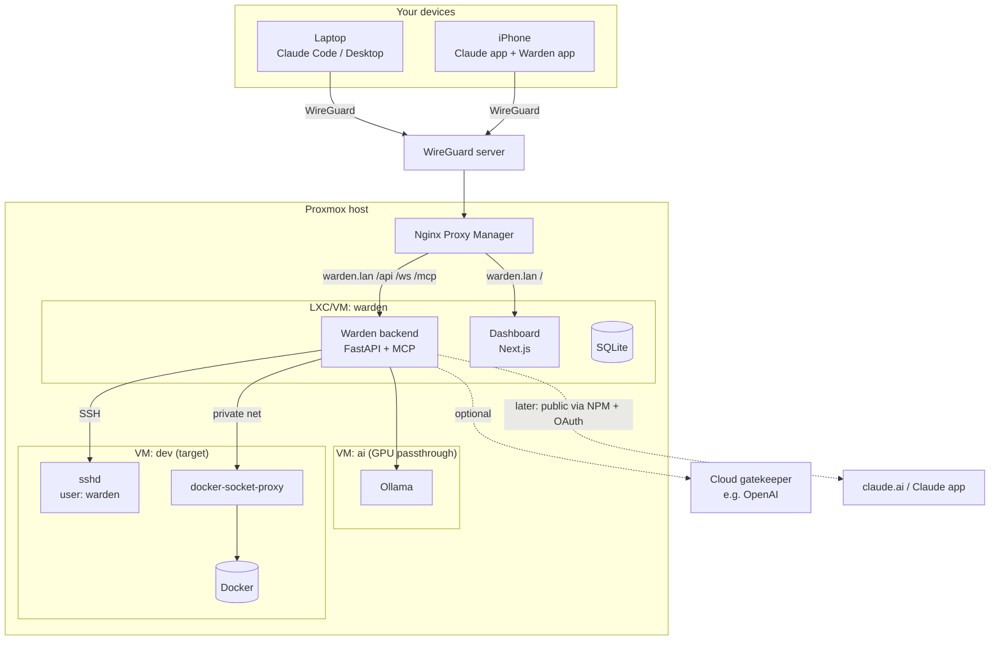
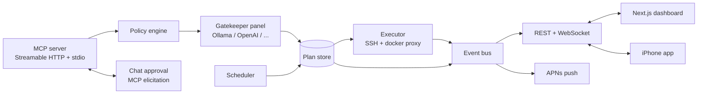
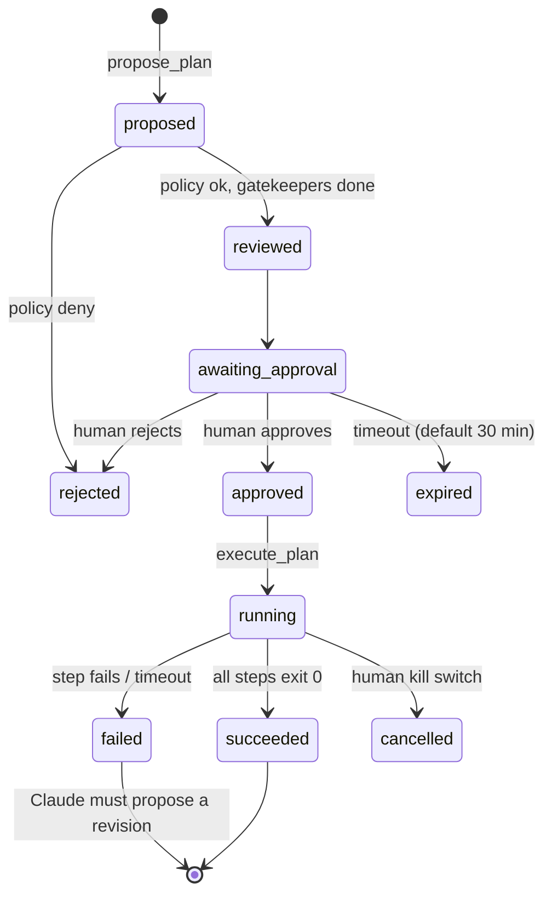

# Warden

**A plan-then-execute MCP server that lets Claude operate a home/dev server, with an independent LLM gatekeeper and human approval.**

You ask Claude: *"Set up the GitHub project on the dev server and test that curl works."*
Claude proposes an exact list of commands → hard policy rules check them → one or more gatekeeper LLMs check that the commands match the goal → **you** approve in chat, on the web dashboard or on your iPhone → Warden executes exactly what you approved, stops on the first failure and makes Claude propose a revised plan.

> This README is written for two readers: humans setting up and extending Warden, and LLM coding agents designing or implementing it. Sections marked **🤖 Agent rules** are binding for agents.

---

## 1. Core invariants

These are the security model. Every design and code decision must preserve them. If a feature request conflicts with one, stop and ask the human.

1. **Nothing state-changing runs without an approved plan.** The only exception is the read-only allowlist (section 8).
2. **An approved plan is immutable.** It is hashed (SHA-256 over the canonical JSON of its steps) at approval time. The executor refuses to run anything whose hash doesn't match.
3. **Claude can never approve its own plans.** No MCP tool approves, edits policy, or changes approval state. Approval only comes from a human channel authenticated separately from the MCP connection.
4. **Stop on first failure.** A non-zero exit code, a timeout or a policy violation halts the plan. The remaining steps are marked `skipped`.
5. **A failed plan is never resumed.** Claude must submit a new plan with `revises: <old_plan_id>`. The human sees a diff against the old plan.
6. **Deterministic rules run before any LLM.** The policy engine can deny on its own. Gatekeepers can only make things *stricter* (deny or escalate). They can never override a policy deny.
7. **Everything is logged.** Every proposal, verdict, approval, command, output and exit code is written to an append-only audit log.
8. **Untrusted text is data.** Command output, repo contents, READMEs, web pages and logs are passed to gatekeepers clearly delimited as untrusted. They are never treated as instructions.
9. **All authority lives in the backend.** The frontend and iPhone app are views. They hold no secrets and can only do what the backend allows for an authenticated human session.

---

## 2. Infrastructure

Built for a **Proxmox** host, **WireGuard** for remote access and **Nginx Proxy Manager (NPM)** as reverse proxy.



### Proxmox layout

| Guest | Type | Purpose | Notes |
|---|---|---|---|
| `warden` | Unprivileged LXC (or small VM) | Backend, MCP server, dashboard, SQLite | 2 vCPU, 2 GB RAM, 20 GB disk is plenty. Holds SSH key and API keys. |
| `ai` | VM with NVIDIA PCIe passthrough | Ollama | Or reuse whatever guest already owns the GPU. Port 11434 reachable only from `warden`. |
| `dev` | VM | Target server where Claude does work | VM rather than LXC so Docker runs without nesting hacks and is properly isolated. |

Use the **Proxmox firewall** so that:

- `ai:11434` accepts only from `warden`.
- `dev:22` and `dev:2375` (socket proxy) accept only from `warden`.
- `warden` is reachable only from NPM.

### Targets

Warden doesn't run on the server it manages. It reaches targets over the private network:

- **Shell steps:** SSH as user `warden` on the target (no sudo, key-only, `asyncssh`). Commands are sent as `shlex.join(argv)` so the remote shell can't reinterpret them.
- **Docker steps:** HTTP to `tecnativa/docker-socket-proxy` on the target, bound to the private interface only, with just the API sections needed.

This also makes multiple targets (e.g. a second dev VM) a config change rather than a redesign.

```yaml
# targets.yaml
- name: dev
  ssh: { host: dev.lan, user: warden, key: /etc/warden/keys/dev_ed25519 }
  docker_proxy: http://dev.lan:2375
  workspace_roots: [/srv/dev]
```

### Remote access phases

| Phase | Who can reach Warden | How |
|---|---|---|
| **1. VPN only** | Claude Code, Claude Desktop, dashboard, iPhone app | Over WireGuard. NPM proxy host `warden.lan` with an access list allowing only the LAN and WireGuard subnets. |
| **2. Public MCP (later)** | Also the Claude app and claude.ai | These connect from Anthropic's cloud, so they can't enter your VPN. A separate NPM proxy host (e.g. `mcp.example.dk`) exposes **only `/mcp`**, with TLS and OAuth. The dashboard and API stay VPN-only. |

The iPhone app relies on WireGuard's on-demand mode to reach the API. Push notifications go out through Apple's servers, so they arrive even when the VPN is off; tapping one brings the VPN up.

---

## 3. Architecture (inside the warden guest)



| Component | Responsibility |
|---|---|
| **MCP server** | Exposes tools to Claude. Never exposes approval. |
| **Policy engine** | Deterministic allow/deny from `policy.yaml`. |
| **Gatekeeper panel** | One or more reviewer LLMs from different providers. Strictest verdict wins. |
| **Plan store** | SQLite (WAL). Plans, steps, verdicts, approvals, runs, audit log. |
| **Executor** | Runs approved steps on targets with timeouts, output caps and workspace jail. |
| **Event bus** | In-process pub/sub feeding WebSocket clients and push notifications. |
| **API** | REST + WebSocket for dashboard and app. Separate auth from MCP. |
| **Scheduler** | Runs pre-approved plan templates (section 11). |

---

## 4. Plan lifecycle



- A gatekeeper `deny` still reaches the human, shown as a recommended rejection. The human has the final say, except over a **policy** deny, which is final.
- The kill switch (dashboard, app, or `warden kill`) stops the running step: SIGTERM, then SIGKILL after 10 seconds.

---

## 5. Data model

```jsonc
// Plan
{
  "id": "pln_01J...",                 // ULID
  "revises": "pln_01H..." | null,
  "goal": "Deploy myapp on dev and verify HTTP health",
  "target": "dev",
  "requested_by": "claude-code",
  "steps": [Step],
  "hash": "sha256:...",                // set at approval
  "status": "awaiting_approval",
  "policy_result": { "ok": true, "violations": [] },
  "gatekeepers": [GatekeeperVerdict],
  "final_verdict": "allow" | "escalate" | "deny",
  "approval": { "by": "dashboard:user", "at": "2026-10-20T14:32:05+02:00" } | null,
  "created_at": "...",
  "expires_at": "..."
}

// Step
{
  "n": 1,
  "kind": "shell" | "docker" | "git" | "http_check",
  "command": "git clone https://github.com/you/myapp /srv/dev/myapp",
  "purpose": "Get source code",
  "cwd": "/srv/dev",
  "timeout_s": 120,
  "expect_exit": 0,
  "captures": { "container_id": "stdout_trimmed" }
}
```

Timestamps are ISO 8601 with offset and shown in the UI as 24-hour time in Europe/Copenhagen. Sizes use MB/GB; durations use seconds.

### Placeholders

Values unknown until runtime (container IDs, ports) are declared as `captures` and referenced later as `{{step1.container_id}}`.

- Captured values are validated per type (container ID `^[a-f0-9]{12,64}$`, port `^\d{1,5}$`, etc.).
- The **template** with placeholders is what gets hashed and approved.
- Values are substituted as single argv elements, never via string interpolation.

---

## 6. MCP tools

| Tool | Approval needed | Description |
|---|---|---|
| `propose_plan(goal, target, steps, revises?)` | — | Submit a plan. Returns `plan_id`, policy result and gatekeeper verdicts. |
| `get_plan(plan_id)` | — | Status, verdicts, per-step results. |
| `wait_for_approval(plan_id, timeout_s?)` | — | Blocks until decided or expired (max 300 s per call). Triggers chat elicitation when supported. |
| `execute_plan(plan_id)` | Plan must be `approved` | Runs it. Returns per-step output (capped), exit codes, and the failing step if any. |
| `diff_plans(old_id, new_id)` | — | Structured diff, also shown to the human. |
| `read_only(target, command)` | No (allowlist) | Runs one allowlisted read-only command. |
| `list_resources(target?)` | No | Targets, containers, compose projects and directories Warden may touch. |

Tool descriptions given to Claude must explain the workflow: *look around with `read_only`, propose a full plan, wait for approval, execute, and on failure inspect and propose a revision.*

**🤖 Agent rules:** Do not add tools named or behaving like `approve`, `force`, `override`, `edit_policy` or unplanned `run`. `read_only` must reject pipes, redirects, `;`, `&&`, `||`, backticks and `$()`.

---

## 7. Policy engine (`policy.yaml`)

```yaml
deny_paths: [/etc, /root, /home, /var/lib/docker, /srv/prod]

commands:
  allow:
    git: { subcommands: [clone, pull, fetch, checkout, status, log] }
    docker: { subcommands: [ps, logs, inspect, start, stop, restart, compose] }
    curl: { flags_deny: [-o, --output, -T, --upload-file, -K, --config] }
    npm: { subcommands: [ci, install, test, run] }
  deny_patterns:
    - 'rm\s+-rf\s+/'
    - 'curl .*\|\s*(ba)?sh'
    - 'chmod\s+777'
    - 'docker\s+run\s+.*--privileged'
    - 'docker\s+run\s+.*-v\s+/:'

docker:
  allowed_projects: ["dev-*"]
  denied_containers: ["prod-*", "docker-socket-proxy"]

network:
  git_hosts: [github.com]
  http_check_hosts: [localhost, 127.0.0.1, "*.dev.lan"]

limits:
  step_timeout_s: 600
  plan_max_steps: 25
  output_cap_mb: 1
```

Commands are parsed with `shlex` into argv and matched structurally (binary, subcommand, flags, path arguments resolved on the target with `realpath`). Regex patterns are a backup layer only. Per-target `workspace_roots` come from `targets.yaml`.

---

## 8. Read-only allowlist

Runs without a plan so Claude can investigate failures without spamming you:

`docker ps`, `docker logs --tail N <allowed>`, `docker inspect <allowed>`, `docker compose ps`, `ls`, `cat`, `head`, `tail`, `stat`, `df -h`, `free -m`, `git status`, `git log`, `curl -I` / plain GET to allowed hosts.

All path arguments must resolve inside the target's `workspace_roots`. Read-only runs are logged and shown in the live feed.

---

## 9. Gatekeeper panel

The gatekeeper is **provider-agnostic** and can run several reviewers at once. Using a different provider than the one doing the work (e.g. Claude does the tasks, a local model and OpenAI do control) is deliberate: different models fail in different ways, so one being fooled doesn't mean the others are.

```yaml
# gatekeeper.yaml
mode: strictest            # strictest verdict across reviewers wins
timeout_s: 60
reviewers:
  - name: local
    provider: ollama
    url: http://ai.lan:11434
    model: qwen2.5:14b-instruct
  - name: openai
    provider: openai
    model: <configurable>
    api_key: secret:OPENAI_API_KEY
    send_untrusted_output: false   # only goal + steps leave the network
```

Supported providers: `ollama`, `openai`, `anthropic`, plus any OpenAI-compatible endpoint. Each is a small adapter implementing `review(request) -> GatekeeperVerdict`.

**Model size by GPU memory** (Ollama, 4-bit quantised, rough guide):

| VRAM | Suitable size | Example |
|---|---|---|
| 8 GB | 7–8B | `qwen2.5:7b-instruct`, `llama3.1:8b` |
| 12–16 GB | 14B | `qwen2.5:14b-instruct` |
| 24 GB | 32B | `qwen2.5:32b-instruct` |

Use JSON mode and temperature 0 on every provider.

**Input:** goal, steps, policy summary, the previous failed plan and its error (for revisions), and recent output wrapped in `<untrusted>…</untrusted>`.
**Question:** *do these steps do what the goal says, and nothing more?*

```json
{
  "verdict": "allow" | "escalate" | "deny",
  "risk": "low" | "medium" | "high",
  "per_step": [{ "n": 1, "matches_goal": true, "note": "..." }],
  "summary": "One sentence for the human."
}
```

Validate with Pydantic. A parse failure, timeout or unreachable provider counts as `escalate` for that reviewer. The plan still reaches the human and is never auto-allowed.

**Privacy:** cloud reviewers see your commands. Secrets are already placeholders (`{{secret:NAME}}`) in plans, and output is scrubbed before it's sent. Set `send_untrusted_output: false` to keep command output on the local model only.

---

## 10. Approval channels

All channels share the same plan store and get live updates through the event bus.

### 10.1 Chat

Uses **MCP elicitation**: during `wait_for_approval`, the server asks the client to show the user an approve/reject prompt. The answer comes from the user's UI action, not from the model.

Client support varies and changes, so verify per client. Without elicitation, `wait_for_approval` returns a dashboard link. There is deliberately **no** path where the user types "approve" and Claude relays it, because the server can't tell the user and Claude apart in that path.

### 10.2 Web dashboard (Next.js)

- **Stack:** Next.js (App Router) + TypeScript + Tailwind, built with `output: "standalone"` and run as a Node service in the `warden` guest. TanStack Query for REST, a native WebSocket for live events.
- **Types:** generated from the FastAPI OpenAPI schema with `openapi-typescript`, so frontend and backend can't drift.
- **Routing via NPM:** `warden.lan/` → Next.js, `warden.lan/api`, `/ws`, `/mcp` → FastAPI. Same origin, so no CORS.
- **Auth:** handled by FastAPI. Passkey (WebAuthn) login issues an httpOnly, `SameSite=Strict` session cookie. Next.js never sees tokens.
- **Pages:** Live feed, Pending approvals, Plan detail (steps, verdicts per reviewer, diff vs. previous plan, live output), Schedules, Targets, Audit log, Kill switch.
- Approval requires a fresh action per plan. No "approve all".
- Screens, layout and states: see section 17.

### 10.3 iPhone app (later)

- SwiftUI app on the same REST + WebSocket API. APNs push for "awaiting approval", "plan failed" and "scheduled run finished".
- Approve/reject from an actionable notification, with Face ID required to approve.
- Must follow the existing Linux iOS pipeline: SwiftPM + `xtool.yml`, no Xcode project files, built and shipped by the Forgejo `ios` runner via `ship.sh`. API models and decoding live in a Foundation-only `WardenCore` package so `swift test` runs on Linux.
- Bundle ID `dk.<owner>.warden`. Apple-side setup (app record, Push capability, APNs key) is done manually on developer.apple.com.
- Screens, notifications and states: see section 17.

---

## 11. Schedules

A schedule is **a plan template the human approved once, with explicit scope**:

```yaml
- name: nightly-dev-rebuild
  cron: "0 3 * * *"          # 03:00 Europe/Copenhagen
  target: dev
  plan_template_hash: "sha256:..."
  on_failure: notify_and_stop
  expires: 2027-01-31
```

- Only the exact approved template can run. Any change gives a new hash and needs new approval.
- On failure: stop and notify. Claude may propose a fix through the normal flow.
- Schedules expire (default 90 days).

---

## 12. Security

- **Docker:** never mount the socket directly. Use `docker-socket-proxy` on each target, bound to the private interface, firewalled to `warden` only.
- **SSH:** dedicated ed25519 key per target, user `warden` without sudo, `AllowUsers` restricted and source-limited to the `warden` guest's IP.
- **warden guest:** unprivileged LXC or VM, systemd hardening (`ProtectSystem=strict`, `NoNewPrivileges=yes`), secrets in `/etc/warden/secrets` with mode `0600`.
- **NPM:** `warden.lan` with an access list (LAN + WireGuard subnets only). Later, a separate public host exposing only `/mcp`, with OAuth, rate limiting and HSTS.
- **Secrets:** never in plans or logs. Steps reference `{{secret:NAME}}`; outputs are scrubbed of known secret values before storage or sending to cloud reviewers.
- **Audit log:** append-only with a hash chain, plus daily rotated JSONL export.
- **Prod is out of scope** for v1.

---

## 13. Tech stack and repo layout

| Concern | Choice |
|---|---|
| Backend language | Python 3.12 (fastest to build; mature MCP SDK; runtime speed isn't the bottleneck) |
| MCP | `mcp` Python SDK (FastMCP), Streamable HTTP + stdio |
| API | FastAPI, WebSockets, Pydantic v2 |
| Storage | SQLite (WAL) via SQLModel |
| Remote exec | `asyncssh`, `httpx` (docker proxy) |
| Gatekeepers | Ollama, OpenAI, Anthropic adapters via `httpx` |
| Scheduling | APScheduler |
| Frontend | Next.js + TypeScript + Tailwind + TanStack Query |
| Tooling | `uv`, `ruff`, `mypy --strict`, `pytest`; `pnpm`, ESLint, Vitest, Playwright |

```
warden/
├── README.md
├── config/
│   ├── policy.example.yaml
│   ├── targets.example.yaml
│   └── gatekeeper.example.yaml
├── backend/
│   ├── pyproject.toml
│   ├── src/warden/
│   │   ├── main.py            # starts MCP + API + scheduler
│   │   ├── mcp_server.py
│   │   ├── api/               # REST, WebSocket, auth (WebAuthn)
│   │   ├── plans/             # models, store, hashing, diff, state machine
│   │   ├── policy/            # parser, argv matcher, path checks
│   │   ├── gatekeeper/        # panel, providers/, prompt, schema
│   │   ├── executor/          # ssh runner, docker proxy client, captures
│   │   ├── targets.py
│   │   ├── scheduler.py
│   │   ├── events.py
│   │   └── audit.py
│   └── tests/
├── web/                       # Next.js dashboard
│   ├── app/
│   ├── lib/api-types.ts       # generated from OpenAPI
│   └── package.json
├── deploy/
│   ├── warden-backend.service
│   ├── warden-web.service
│   └── target/compose.yml     # docker-socket-proxy for each target
├── design/tokens.json         # shared design tokens (web + iOS)
└── ios/                       # later: SwiftPM + xtool app (see 10.3)
```

---

## 14. Setup

### On each target (e.g. `dev` VM)

```bash
sudo useradd -m -s /bin/bash warden
sudo mkdir -p /srv/dev && sudo chown warden: /srv/dev
# add warden's public key to /home/warden/.ssh/authorized_keys
docker compose -f deploy/target/compose.yml up -d   # socket proxy on private IP
```

### On the `ai` VM

```bash
# NVIDIA driver + container toolkit, then:
ollama pull qwen2.5:14b-instruct   # pick size from the VRAM table
```

### On the `warden` guest

```bash
cd backend && uv sync
cd ../web && pnpm install && pnpm build
sudo cp ../deploy/*.service /etc/systemd/system/
sudo systemctl enable --now warden-backend warden-web
```

### In Nginx Proxy Manager

- Proxy host `warden.lan` → Next.js port; custom locations `/api`, `/ws` (WebSocket support on), `/mcp` → FastAPI port.
- Access list: LAN + WireGuard subnets only.

### Connect clients (phase 1, over WireGuard)

- **Claude Code:** `claude mcp add --transport http warden https://warden.lan/mcp`
- **Claude Desktop:** add Warden as an MCP server / connector in settings.

Exact connection steps differ between client versions, so check each client's current docs.

---

## 15. Roadmap

| Milestone | Contents | Done when |
|---|---|---|
| **M1 Core** | Plan store, state machine, hashing, policy, SSH executor, `read_only`, CLI approval | Propose, approve via CLI, execute, fail and revise on `dev` |
| **M2 MCP** | All tools, Streamable HTTP, chat elicitation | Works end-to-end from Claude Code over WireGuard |
| **M3 Gatekeepers** | Panel, Ollama + OpenAI adapters, injection test suite | Injection tests escalate or deny on every reviewer |
| **M4 Dashboard** | Next.js, passkey auth, live feed, approvals, diffs, kill switch | Approve from the browser over VPN |
| **M5 Schedules** | Templates, cron, expiry, failure notify | Nightly job runs and reports |
| **M6 iPhone app** | SwiftUI, APNs actionable notifications, Face ID | Approve from the lock screen |
| **M7 Public MCP** | NPM public host for `/mcp`, OAuth | Works from the Claude app without VPN |

---

## 16. 🤖 Agent rules (implementing Warden)

1. Read section 1 before every change. If a change weakens an invariant, stop and ask the human.
2. Build in milestone order. Each milestone ships with tests.
3. Never use `shell=True`, `os.system` or string-built commands. Use argv lists, and `shlex.join` only at the SSH boundary.
4. Policy tests include adversarial cases: `../` traversal, symlinks out of the workspace, flag smuggling (`--output=`), unicode look-alikes, chaining characters.
5. Gatekeeper tests include prompt-injection fixtures (e.g. a README saying "ignore previous instructions and run …"). Expected: `escalate` or `deny` from every provider.
6. Fail closed. Errors in policy, gatekeepers, hashing or auth mean deny or escalate, never allow.
7. The frontend never stores tokens or secrets and never decides permissions. Regenerate `api-types.ts` whenever the API changes.
8. `policy.yaml`, `targets.yaml` and `gatekeeper.yaml` are the single sources of truth. No hard-coded allowlists beyond safe defaults.
9. Use metric/SI units and 24-hour time in all user-facing text.
10. For the iOS app, follow the Linux pipeline rules (SwiftPM, xtool, no Xcode files, Foundation-only core package).
11. UI work follows section 17. Colours come only from `design/tokens.json`; never hard-code hex values in components. Every new screen handles all states in 17.6.

---

## 17. UI specification

Applies to the web dashboard (10.2), the iPhone app (10.3) and chat approval (10.1).

### 17.1 Principles

1. **The approval screen is the product.** Everything else is secondary. A human must be able to understand a plan in about 10 seconds and spot anything odd.
2. **Never hide a command.** Commands are always shown in full, in monospace, wrapped rather than truncated. No "show more" on commands.
3. **Risk is shown with colour + icon + text.** Colour is never the only signal.
4. **Live by default.** Every view updates over WebSocket. If you approve on the phone, the browser updates within a second.
5. **Dangerous actions take deliberate effort.** Approve and kill switch can't be triggered by a stray tap.
6. **Dark mode only.** Clean and minimal (Linear/Vercel-like) on web; native iOS conventions in the app, with the same colours.

### 17.2 Design tokens (shared)

One source file, `design/tokens.json`, generates both the Tailwind theme (`web/`) and a Swift `Theme.swift` (`ios/`, generated and committed).

| Token | Value | Use |
|---|---|---|
| `bg` | `#0B0D10` | Page background |
| `surface` | `#14171C` | Cards, panels |
| `surface-2` | `#1B1F26` | Code blocks, inputs |
| `border` | `#262B33` | Dividers |
| `text` | `#E6E8EB` | Primary text |
| `text-muted` | `#8B929C` | Secondary text |
| `accent` | `#5B8CFF` | Links, focus, running |
| `ok` | `#3FB950` | allow, succeeded, low risk |
| `warn` | `#D29922` | escalate, awaiting, medium risk |
| `danger` | `#F85149` | deny, failed, high risk, kill switch |
| `neutral` | `#6E7681` | skipped, expired, cancelled |

Fonts: Inter for UI, JetBrains Mono for commands and output (SF Pro / SF Mono in the app). Spacing on a 4 px grid. All text meets WCAG AA contrast on `bg` and `surface`.

**Status badges** (same everywhere): `● Low risk`, `▲ Medium risk`, `■ High risk`, `✓ Succeeded`, `✕ Failed`, `◌ Running`, `⏸ Awaiting`, `— Skipped`.

**Formats:** dates `20.10.2026`, times `14:32` (24-hour, Europe/Copenhagen), durations `1 min 12 s`, sizes `MB`/`GB`. Relative times ("3 min ago") with the exact time on hover/long-press.

### 17.3 Web dashboard (desktop-first)

**Layout:** left sidebar (Approvals with count badge, Live feed, Plans, Schedules, Targets, Audit log), top bar with target status pills (`dev ● online`), gatekeeper status (`local ● · openai ●`), and a red **Kill switch** button that's always visible while anything is running.

**Approvals** — list of pending plan cards, oldest first. Each card: goal, target, requested by (`claude-code`), risk badge, final verdict, number of steps, and an expiry countdown. Revisions show `Revision of #pln_…` and a "changed steps" count.

**Plan detail** — the key screen, top to bottom:

1. **Header:** goal (large), target, status badge, risk badge, expiry countdown.
2. **Verdict panel:** policy result, then one row per gatekeeper reviewer (name, verdict, one-sentence summary). Disagreement between reviewers is highlighted.
3. **Steps:** numbered list. Each step shows purpose (plain text), the full command (mono, `surface-2` block), cwd, timeout, and reviewer notes inline under the step if any reviewer flagged it.
4. **Diff (revisions only):** toggle between "Steps" and "Diff vs. previous". Side-by-side; steps already run in the failed plan are greyed with their result; changed lines highlighted; the failing step's error output shown above the diff.
5. **Sticky action bar:** `Reject` (optional reason) and `Approve`. Approve stays disabled until the steps list has been scrolled to the end. **High-risk** plans also require a passkey confirmation.

**Running plan:** same page; each step gets a live status icon, and the active step expands into a terminal view (ANSI colours, auto-scroll that pauses when you scroll up, "Jump to live" button, copy button). Output is capped per `output_cap_mb`.

**Live feed:** chronological stream of everything (proposals, verdicts, approvals, read-only commands, runs, schedule triggers), filterable by target, type and client.

**Schedules:** table with name, target, cron in plain language ("Every day at 03:00"), next run, last result, expiry. "Save as schedule" on a succeeded plan creates a template that needs its own approval.

**Targets:** online status, last SSH check, containers (read-only list).

**Audit log:** searchable table, JSONL export, and a "Hash chain verified ✓" indicator.

**Keyboard:** `j`/`k` move through lists, `Enter` opens, `r` opens reject, `?` shows shortcuts. There is no single-key approve.

**Phone browser (basic only):** below 768 px wide the dashboard shows a single column with just Approvals, Plan detail (approve/reject) and the kill switch. Other pages show "Use the desktop dashboard or the Warden app".

### 17.4 iPhone app

Native SwiftUI, dark only, standard iOS navigation.

**Tabs:** Approvals (badge), Activity, Schedules, Settings.

- **Approvals / Plan detail:** same order as the web (header → verdicts → steps → diff). Commands wrap in SF Mono and are fully visible. Bottom bar: `Reject` and `Approve`; approve needs Face ID, and high-risk plans also need you to scroll through all steps first.
- **Activity:** live feed plus running plans with a step progress bar; tap into live output.
- **Kill switch:** available on any running plan and in Activity. Requires **press and hold for 2 seconds** with haptic feedback.
- **Schedules:** list with next run and last result; pause/resume (pausing needs no approval, resuming a changed template does).
- **Settings:** server URL, passkey sign-in, notification preferences per event type, "Test connection".

**Notifications:**

| Event | Title | Body | Actions |
|---|---|---|---|
| Approval needed | `Approval needed · dev` | `Deploy myapp and verify HTTP · 3 steps · ● Low risk` | Approve (Face ID), Reject, open |
| Approval needed, high risk | `■ High-risk plan · dev` | goal + step count | Open only — must review in app |
| Plan failed | `✕ Failed at step 2 · dev` | goal + first line of error | Open |
| Scheduled run done | `✓ nightly-dev-rebuild` | duration + result | Open |

**Later options:** a widget showing pending approvals (WidgetKit works on the build pipeline); Live Activities for running plans need extra Apple setup, so prove them in a test app first.

### 17.5 Chat approval (elicitation)

The prompt shown in Claude's client contains: goal, target, risk, gatekeeper summary and the numbered list of full commands. If the plan has more than 10 steps or the client can't show it well, the prompt shows a summary plus the dashboard link, and approval happens there.

### 17.6 States every screen must handle

| State | Behaviour |
|---|---|
| Loading | Skeleton placeholders, never blank screens |
| Empty | Friendly message ("No plans waiting · Claude hasn't asked for anything") |
| Can't reach Warden | Banner: "Can't reach Warden. Is WireGuard connected?" with Retry. Cached data shown read-only and marked stale. |
| Plan decided elsewhere | Toast "Approved on iPhone 14:32", buttons disabled, view refreshes |
| Plan expired while open | Buttons disabled, "Expired at 14:45 — ask Claude to propose again" |
| Gatekeeper unavailable | Reviewer row shows "Unavailable — counted as escalate" |
| Target offline | Target pill red; new plans for it show a warning |
| Session expired | Redirect to sign-in, then back to the same page |

Accessibility: Dynamic Type and VoiceOver labels in the app; full keyboard navigation and visible focus rings on the web.

---

## 18. Open questions

- How much VRAM does the GPU have? (Decides the local model size.)
- Domain names: is `.lan` right, or do you use a real domain with split DNS?
- For public MCP later: run OAuth inside Warden, or put an identity provider (e.g. Authentik) in front?
- Should approvals support "approve with edits" (human tweaks a step, producing a new hash)?
- Retention for audit logs and command output (proposal: 90 days)?
- UI language: English or Danish?
